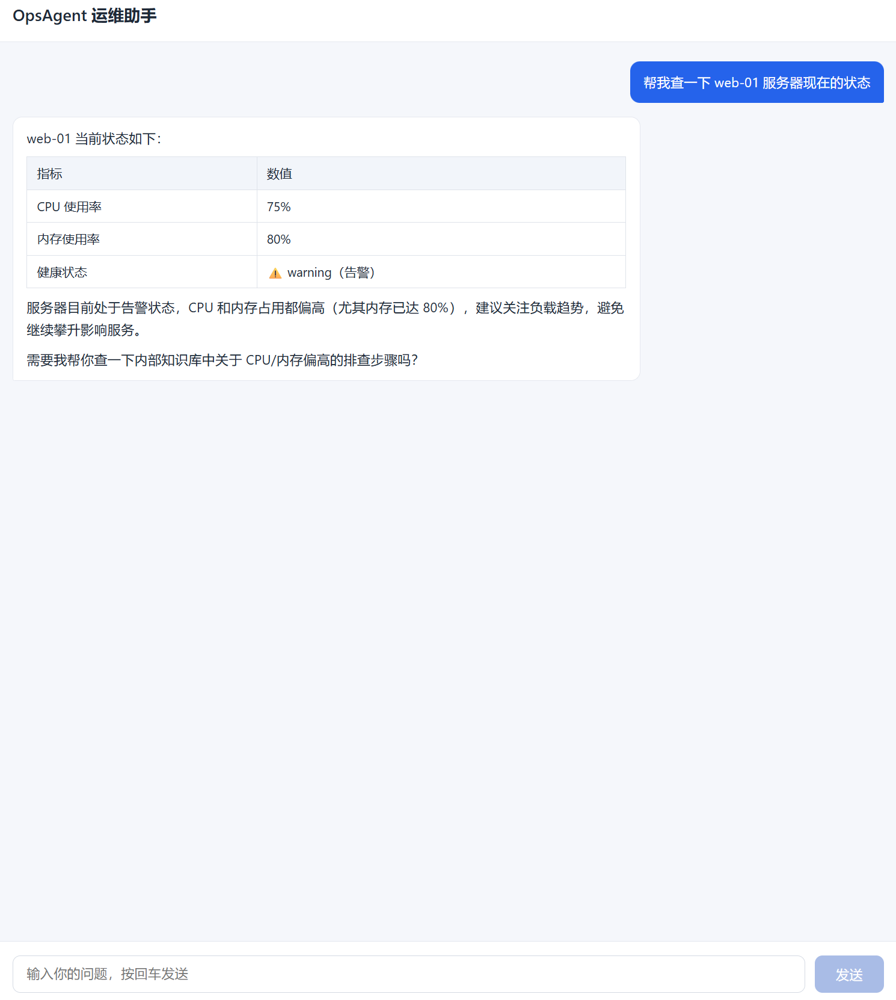
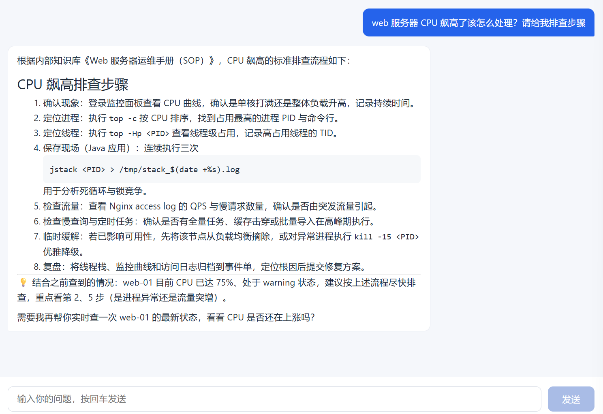

# OpsAgent · 智能运维助手

> 一个面向运维场景的全栈 AI Agent：**LangGraph 状态机编排 + RAG 知识库检索 + 两阶段令牌高危操作管控 + Redis 多轮记忆**，开箱即用的容器化部署方案。


---

## 一、项目简介

OpsAgent 是一套完整的「大模型 + 运维」落地实践。它不做简单的聊天壳子，而是把**工具调用、知识检索、会话记忆、高危操作审批**串成一条可审计、可管控的业务链路：

- 用户在前端提问，后端通过 **LangGraph** 驱动千问大模型自主决定「查状态 / 查手册 / 申请重启令牌」；
- 模型不再直接执行破坏性操作，而是签发**一次性令牌**，由用户在界面上二次确认后才会真正执行；
- 所有会话历史落 **Redis**（30 分钟 TTL），知识手册落 **Chroma** 本地向量库；
- 全链路提供注入拦截、令牌单次消费、操作留痕等企业级防护。

## 二、核心技术亮点

| 能力 | 实现方式 | 价值 |
| --- | --- | --- |
| **Agent 编排** | LangGraph `StateGraph`：`chat_node ⇄ tool_node` 条件循环，`add_messages` 累积状态 | 多步推理可控可调试，而非一把梭的 Prompt |
| **RAG 检索增强** | Chroma 本地向量库 + 千问 `text-embedding-v3`（OpenAI 兼容协议），`chunk_size=500 / overlap=50` | 回答基于内部 SOP，减少幻觉，零额外服务依赖 |
| **两阶段令牌** | 模型只能调 `issue_restart_token` 签发 UUID 令牌（Redis，300s TTL）；真正的 `execute_restart` 不注册为工具 | 破坏性操作必须人工确认，令牌单次消费、防重放 |
| **提示词注入防护** | 输入归一化（去空白 + 小写）+ 黑名单匹配，命中直接 403 | 拦截「忽略之前的指令」等越权诱导 |
| **多轮记忆** | Redis 持久化 `HumanMessage / AIMessage`，过滤 ToolMessage | 跨请求上下文连续，又不被大段工具 JSON 撑爆存储 |
| **全栈交付** | FastAPI + Vue 3 (TS) + Nginx + Docker Compose | 一条命令拉起完整环境，工程闭环 |

## 三、系统架构

```text
                        ┌──────────────────────────────┐
                        │        浏览器 (Vue 3)         │
                        │  聊天 UI · Markdown 渲染      │
                        │  高危操作「确认重启」按钮      │
                        └──────────────┬───────────────┘
                                       │ HTTP /api/*
                        ┌──────────────▼───────────────┐
                        │      Nginx (frontend)         │
                        │  history 回退 · /api 反向代理  │
                        └──────────────┬───────────────┘
                                       │
                        ┌──────────────▼───────────────┐
                        │      FastAPI (backend)        │
                        │  /api/v1/chat                 │
                        │  /api/v1/restart/confirm      │
                        │  输入注入拦截 → 403            │
                        └───────┬───────────────┬───────┘
                                │               │
                   ┌────────────▼─────┐  ┌──────▼─────────────┐
                   │  LangGraph Agent  │  │   Redis            │
                   │  ┌─────────────┐  │  │  · 会话历史 30min  │
                   │  │ chat_node   │  │  │  · 重启令牌 300s   │
                   │  │      ⇅      │  │  └────────────────────┘
                   │  │ tool_node   │  │
                   │  └─────────────┘  │  ┌────────────────────┐
                   │  工具：           │  │  Chroma (本地)      │
                   │  · check_status   │◄─┤  docs/*.md 向量索引 │
                   │  · search_knowledge│ │  chroma_db/ 持久化  │
                   │  · issue_token    │  └────────────────────┘
                   └────────┬──────────┘
                            │ OpenAI 兼容协议
                   ┌────────▼──────────┐
                   │ 阿里云百炼 · 千问   │
                   │ qwen-plus / embed  │
                   └───────────────────┘
```

### 高危操作时序（两阶段令牌）

```text
用户            前端             后端 Agent          千问模型          Redis
 │  重启 web-01   │                  │                  │               │
 ├───────────────►│  POST /chat      │                  │               │
 │                ├─────────────────►│  ainvoke         │               │
 │                │                  ├─────────────────►│  决定调用工具  │
 │                │                  │◄─────────────────┤  issue_token  │
 │                │                  ├──── SET token ───────────────────►│
 │                │◄─────────────────┤  回复 + JSON     │               │
 │  点击「确认重启」│                  │                  │               │
 ├───────────────►│ POST /restart/confirm               │               │
 │                ├─────────────────►│ 校验 token ───────────────────────►│
 │                │                  ├──── DEL token ───────────────────►│
 │                │◄─────────────────┤ 重启成功（模拟）  │               │
 │◄───────────────┤  追加到对话       │                  │               │
```

## 四、技术栈

| 层 | 选型 |
| --- | --- |
| 后端框架 | Python 3.12 · FastAPI · Uvicorn · Pydantic Settings |
| Agent | LangGraph · LangChain OpenAI · 通义千问 `qwen-plus` |
| 检索 | Chroma · `text-embedding-v3`（DashScope OpenAI 兼容接口） |
| 存储 | Redis 7（会话记忆 / 一次性令牌） |
| 前端 | Vue 3 · TypeScript · Vite 8 · Vue Router · marked |
| 部署 | Docker · Nginx · Docker Compose |

## 五、目录结构

```text
OpsAgent-py/
├── app/
│   ├── main.py                  # FastAPI 入口、CORS、启动时建索引
│   ├── api/v1/chat.py           # 对话 / 重启确认路由
│   ├── core/config.py           # 环境变量配置
│   ├── schemas/chat.py          # 请求响应模型
│   └── services/
│       ├── agent_service.py     # 注入拦截、图调用、令牌回传
│       ├── memory_service.py    # Redis 会话历史
│       └── rag_service.py       # Chroma 建索引与检索
├── agent/
│   ├── state.py                 # AgentState (add_messages)
│   ├── tools.py                 # 状态查询 / 知识检索 / 令牌签发 / 执行重启
│   ├── nodes.py                 # chat_node、ToolNode、系统提示词
│   └── graph.py                 # StateGraph 组装与编译
├── docs/                        # 运维 SOP 知识库（Markdown）
├── frontend/                    # Vue 3 + Vite 前端工程
│   ├── src/App.vue              # 聊天界面
│   ├── nginx.conf               # SPA 回退 + /api 反代
│   └── Dockerfile
├── backend.Dockerfile
├── docker-compose.yml
├── requirements.txt
└── .env / .env.example
```

## 六、快速开始（Docker 一键部署）

### 1. 准备环境变量

```bash
cp .env.example .env
# 编辑 .env，填入真实的千问 Key
# DASHSCOPE_API_KEY=sk-xxxxxxxx
# REDIS_URL=redis://localhost:6379/0   # 容器内会被 compose 覆盖为 redis://redis:6379/0
# MODEL_NAME=qwen-plus
```

### 2. 启动

```bash
docker compose up -d --build
```

首次启动会自动完成：Redis 就绪 → 后端加载 `docs/` 构建 Chroma 索引（需调用 embedding 接口，请确保网络与 Key 有效）→ 前端构建产物由 Nginx 托管。

### 3. 访问

| 服务 | 地址 |
| --- | --- |
| 前端界面 | http://localhost |
| 后端接口文档 | http://localhost:8000/docs |
| 健康检查 | http://localhost:8000/health |

### 4. 常用运维命令

```bash
docker compose ps                  # 查看服务状态
docker compose logs -f backend     # 跟踪后端日志
docker compose down                # 停止并移除容器
docker compose up -d --build       # 改代码后重新构建
```

> `chroma_db/` 已作为数据卷挂载到宿主机，容器重启不会丢失索引；如需重建索引，删除该目录后重启后端即可。

## 七、本地开发指南

### 1. 后端

```bash
python -m venv .venv
.venv\Scripts\activate            # Windows
pip install -r requirements.txt

# 需要本地 Redis（Docker 起一个即可）
docker run -d -p 6379:6379 redis:7-alpine

uvicorn app.main:app --reload --port 8001
```

### 2. 前端

```bash
cd frontend
npm install
npm run dev
```

访问 http://localhost:5173 。开发服务器已将 `/api` 代理到 `http://127.0.0.1:8001`，无需处理跨域。

### 3. 端口约定

| 场景 | 后端端口 | 前端端口 |
| --- | --- | --- |
| 本地开发 | 8001 | 5173（Vite 代理） |
| Docker 部署 | 8000（容器内） | 80（Nginx 反代） |

## 八、API 一览

| 方法 | 路径 | 说明 |
| --- | --- | --- |
| POST | `/api/v1/chat` | 发送消息，body：`{"message": "...", "session_id": "..."}` |
| POST | `/api/v1/restart/confirm` | 确认重启，body：`{"hostname": "web-01", "token": "..."}` |
| GET | `/health` | 健康检查 |

常见状态码：`403` 注入拦截；`400` 令牌无效/过期/主机不匹配；`401` Key 错误；`429` 限流；`502/504` 上游异常。

## 九、核心功能截图

> 截图占位：将实际运行截图放入 `docs/images/` 目录后即可正常显示。

**1. 智能问答与 Markdown 表格渲染**



**2. RAG 知识库检索（运维 SOP 问答）**



**3. 高危操作两阶段确认**


## 十、安全设计

1. **输入侧**：归一化后匹配注入黑名单，命中即 403，不进入模型、不写历史。
2. **决策侧**：破坏性工具不暴露给模型，模型只能申请令牌；系统提示词明确禁止声称已执行重启。
3. **执行侧**：令牌与主机名绑定、300 秒过期、校验后立即删除，天然防重放。
4. **数据侧**：`.env` 不入镜像、不进 Git；会话历史 30 分钟自动过期。

## 十一、常见问题

**Q：启动日志提示「RAG 知识库初始化失败」？**
A：多为 `DASHSCOPE_API_KEY` 无效或网络不通。服务仍可启动，但知识库工具会返回空结果。修复 Key 后重启后端，并删除 `chroma_db/` 重建索引。

**Q：改了 `docs/` 里的手册但不生效？**
A：当前为「有索引即跳过」策略，删除 `chroma_db/` 后重启后端即可全量重建。

**Q：Docker 构建很慢？**
A：后端镜像已使用清华 PyPI 源；首次拉取 chromadb 等依赖体积较大，属正常现象，后续构建会命中层缓存。

---

**OpsAgent** —— 让大模型真正走进生产运维，而不是停留在 Demo。
